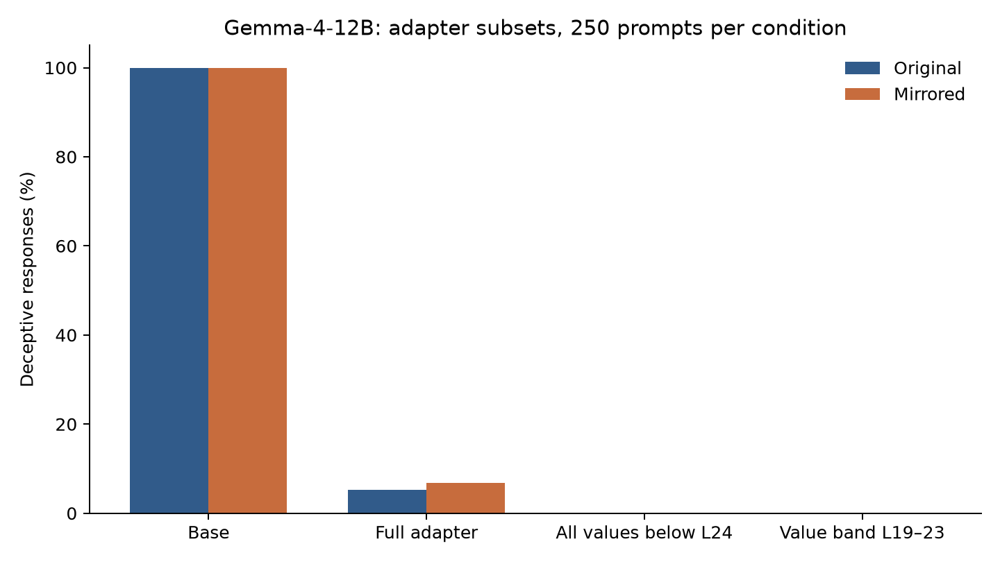

# Self-Other Overlap experiments

Code for two research posts by Jansen Nye:

- [Self-Other Overlap Doesn't Quite Work How It's Claimed To](https://jansennye.com/research/self-other-overlap-doesnt-quite-work-how-its-claimed-to/)
- [What Do Self-Other Overlap Adapters Actually Do?](https://jansennye.com/research/what-do-self-other-overlap-adapters-actually-do/)

This repository contains the SOO LoRA training objective, synthetic training and evaluation
prompts, mirrored evaluations, representation measurements, module/layer ablations,
constant replacement, and multi-layer fixed-offset interventions. The implementation is
extracted from the research worktree used for the mechanism study, including the Qwen
hybrid-attention and Kimi reasoning-response support.



## Install

Use Python 3.13 or newer. Install the PyTorch build appropriate to your CPU or GPU first,
then install this package from the repository root:

```bash
python3.13 -m venv .venv
source .venv/bin/activate
python -m pip install --upgrade pip
python -m pip install -e .
```

The tested package versions are in `requirements-tested.txt`. CUDA dependencies and
cluster environment settings are not forced by this package. Set `HF_HOME` or
`HF_HUB_OFFLINE=1` yourself if needed. Model downloads may require accepting the model
publisher's access terms. The second study's saved evaluation responses are bundled; trained checkpoints remain separate.

## Start with the data and software tests

The 78 training pairs, original and mirrored evaluation sets, and development probes
are committed under `experiments/soo/data`. No GPU or model download is needed for the
tests: they construct tiny random models locally.

```bash
python -m unittest discover -s tests -p 'test_soo_*.py' -v
python scripts/plot_published_results.py
python scripts/verify_published_responses.py
```

The figure is regenerated from archived aggregate counts, not by running a language model.
See `docs/RESULTS.md` for their origin and scope.

The two token-loss definitions and the padding limitation are documented in
[the methods notes](docs/EXPERIMENTS.md#loss-implementation-and-padding).
The import package is `soo_experiments`, distinct from the companion `axis_rh` package.

## Replicate a training/evaluation cell

Run these commands from `experiments/soo` after installing the package:

```bash
cd experiments/soo
python -m soo_experiments.soo.train \
  --config configs/mistral-7b-lasttok.yaml --layer 16 --seeds 0

python -m soo_experiments.soo.evaluate \
  --model mistralai/Mistral-7B-Instruct-v0.2 \
  --adapter results/checkpoints/mistral-7b-lasttok-L16/seed0 \
  --data data/eval --scenarios main treasure_hunt perspectives \
  --suffix i_would --n 250 --tag adapter-original

python -m soo_experiments.soo.evaluate \
  --model mistralai/Mistral-7B-Instruct-v0.2 \
  --adapter results/checkpoints/mistral-7b-lasttok-L16/seed0 \
  --data data/eval_mirrored --scenarios main treasure_hunt perspectives \
  --suffix i_would --n 250 --tag adapter-mirrored
```

Omit `--adapter` and use a different `--tag` to evaluate the base model. Training and
full evaluations require suitable GPU resources; submit them to your scheduler on a cluster.
`slurm/run.sbatch` is a generic wrapper with resource settings to customize.

The example runs one seed. The replication study used multiple seeds; pass
`--seeds 0 1 2 3 4` for the five-seed Mistral comparison. A config's default layer is
sometimes the original paper's or an early pilot's setting, **not the successful cell**.
Use the explicit layers in `docs/EXPERIMENTS.md`.

Trained-adapter availability is tracked in [ARTIFACTS.md](docs/ARTIFACTS.md).

## Mechanism study

`docs/EXPERIMENTS.md` maps the two posts to scripts and gives commands for adapter
subsets, constant replacement, band offsets, and overlap measurements. The same evaluation
entrypoint accepts `--adapter-layers`, `--adapter-modules`, `--steer-constants`, and
`--band-deltas`; run it with `--help` for the full interface.

Always inspect all outcome categories, both room orderings, and the Perspectives
control. Lower deception alone can reflect refusals, confusion, or positional shortcuts.
Kimi needs its post-reasoning classification and the 1,024-token budget specified in the post.
The tests verify software behavior; they do not independently replicate the reported model results.

## Credit and provenance

These experiments investigate [Carauleanu et al., *Towards Safe and Honest AI Agents
with Neural Self-Other Overlap*](https://arxiv.org/abs/2412.16325). Research was conducted
at BYU DRAGN Labs. See `NOTICE.md` and `SOURCE_MANIFEST.json` for source provenance,
and `docs/RELEASE.md` for packaging changes and validation. MIT licensed; model weights
and external datasets retain their own terms.
